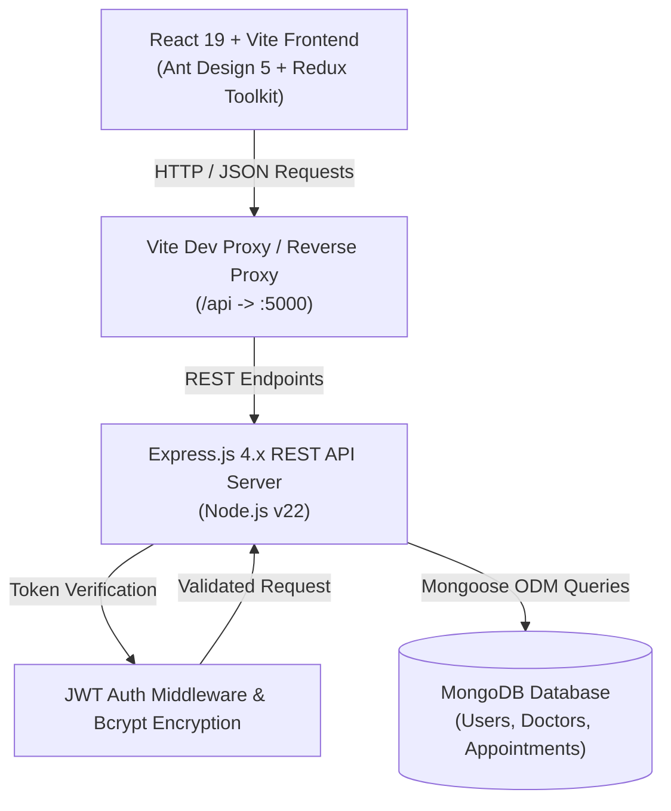
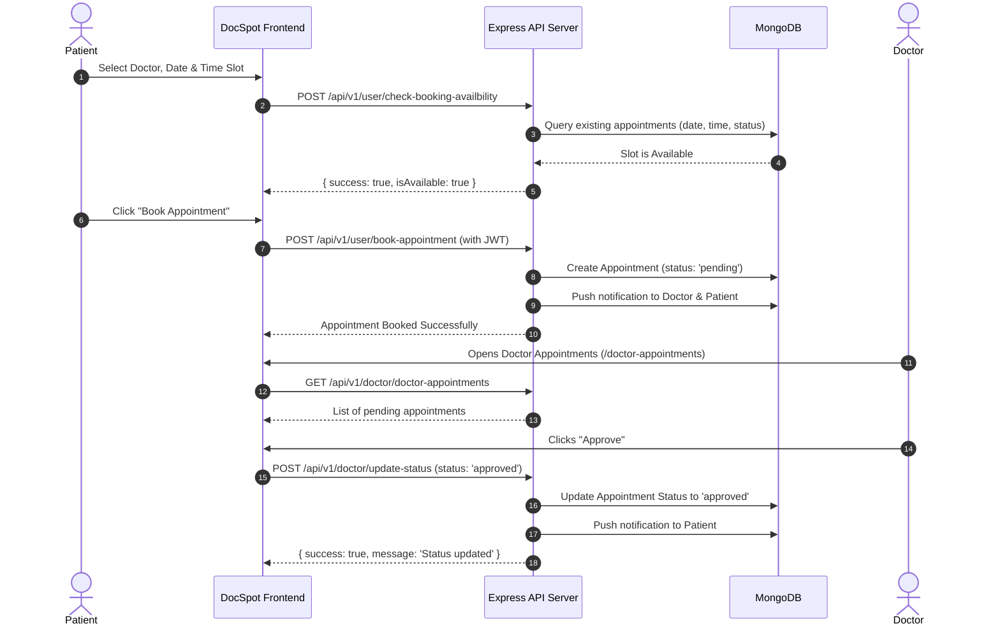

# 🩺 DocSpot — Seamless Appointment Booking for Health

[](https://reactjs.org/)
[](https://vitejs.dev/)
[](https://nodejs.org/)
[](https://expressjs.com/)
[](https://www.mongodb.com/)
[](https://redux-toolkit.js.org/)
[](https://ant.design/)
[](LICENSE)

> **DocSpot** is a modern, full-stack healthcare appointment scheduling platform connecting patients with verified medical specialists. The platform streamlines doctor discovery, real-time slot checking, appointment management, role-based workflows, and automated in-app notifications.

---

## 📌 Table of Contents

- [Overview & Objectives](#-overview--objectives)
- [Key Features by Role](#-key-features-by-role)
- [System Architecture](#-system-architecture)
- [Data Flow & Lifecycle Diagrams](#-data-flow--lifecycle-diagrams)
- [Tech Stack](#-tech-stack)
- [Database Schema](#-database-schema)
- [REST API Endpoints](#-rest-api-endpoints)
- [Directory Structure](#-directory-structure)
- [Installation & Getting Started](#-installation--getting-started)
- [Demo Credentials](#-demo-credentials)
- [Team & Academic Attribution](#-team--academic-attribution)
- [Future Roadmap](#-future-roadmap)

---

## 🌟 Overview & Objectives

Traditional medical appointment booking is hindered by crowded waiting rooms, manual phone calls, scheduling conflicts, and lack of real-time doctor availability. **DocSpot** solves these pain points by providing:

1. **Instant Digital Scheduling**: Patients browse verified doctors, check live slot availability, and book appointments in seconds.
2. **Two-Sided Portal Experience**: Tailored interfaces for Patients, Doctors, and Administrators with dedicated sidebars and permissions.
3. **Doctor Verification Workflow**: Doctors submit professional credentials and clinic hours; Admins review and approve accounts before they appear publicly.
4. **Real-Time Notifications**: Instant in-app alerts on appointment requests, approvals, rejections, and status changes.

---

## 🚀 Key Features by Role

### 🧑‍💼 1. Patient Portal
- **Doctor Discovery**: Interactive cards showcasing doctor names, specializations, consultation fees, clinic locations, and experience.
- **Search & Filter**: Filter doctors by medical specialty (Cardiology, Dermatology, General Physician, etc.) or clinic keyword.
- **Real-Time Slot Availability**: Instant check to ensure no overlapping bookings for the selected date and time.
- **1-Click Appointment Booking**: Submit booking requests directly to the doctor.
- **"My Appointments" Dashboard**: Track booking status (`Pending`, `Approved`, `Rejected`) with timestamps.
- **Doctor Application**: Users can apply to list their own medical practice on the platform.
- **Notification Center**: Tabbed interface (`Unread` / `Read`) to view and clear alerts.

### 🩺 2. Doctor Portal
- **Doctor Workspace**: Role-activated navigation menu with doctor-specific tools.
- **Patient Appointment Queue**: View all incoming appointment requests with patient contact details.
- **Status Decisioning**: 1-click **Approve** or **Reject** actions that immediately update the patient's record.
- **Profile & Clinic Management**: Modify consultation fees, clinic address, contact info, and active consultation hours (`timings`).
- **Real-Time Appointment Alerts**: Instant notifications when new patients schedule visits.

### 🛡️ 3. Administrator Portal
- **Platform Management**: Centralized administrative dashboard.
- **Doctor Approval Pipeline**: Review doctor applications and **Approve**, **Reject**, or **Revoke** practitioner credentials.
- **User Directory**: View all registered users with role badges (`Admin`, `Doctor`, `Patient`) and account deletion/moderation capability.
- **Global Appointments Ledger**: View all appointments booked across all practitioners and patients platform-wide.

---

## 🏗️ System Architecture

DocSpot is architected using a decoupled **MERN** (MongoDB, Express, React, Node.js) design with RESTful API communication and state persistence via Redux Toolkit.



---

## 🔄 Data Flow & Lifecycle Diagrams

### Appointment Booking & Approval Lifecycle



---

## 💻 Tech Stack

| Layer | Technologies Used | Description |
|---|---|---|
| **Frontend Framework** | React.js 19, Vite 7 | High-performance SPA with modern ES Modules |
| **State Management** | Redux Toolkit, React-Redux | Global user authentication & alert state |
| **UI Component Library** | Ant Design (antd 5.26), Font Awesome 6 | Enterprise-ready accessible components & icons |
| **Routing** | React Router DOM 7 | Role-based Protected and Public route guards |
| **HTTP Client** | Axios 1.10 | Promise-based HTTP client with Bearer Token headers |
| **Backend Framework** | Node.js (v22), Express.js (v4.21) | RESTful web API micro-architecture |
| **Database & ODM** | MongoDB, Mongoose 7.8 | NoSQL document database with strict schemas |
| **Security & Auth** | JSON Web Tokens (JWT), Bcrypt.js | Stateless authentication & salted password hashing |
| **Dates & Timings** | Moment.js | Date parsing, slot calculations, and formatting |

---

## 🗄️ Database Schema

### 1. `users` Collection
| Field | Type | Attributes | Description |
|---|---|---|---|
| `_id` | ObjectId | Primary Key | Unique user identifier |
| `name` | String | Required | Full name of user |
| `email` | String | Required, Unique | User email address |
| `password` | String | Required | Salted bcrypt password hash |
| `phone` | String | Required | Contact phone number |
| `isAdmin` | Boolean | Default: `false` | Administrator role flag |
| `isDoctor` | Boolean | Default: `false` | Approved medical doctor flag |
| `notification` | Array | Default: `[]` | Unread notifications queue |
| `seennotification`| Array | Default: `[]` | Read/archived notifications |
| `timestamps` | Date | `createdAt`, `updatedAt` | Auto-generated timestamps |

### 2. `doctors` Collection
| Field | Type | Attributes | Description |
|---|---|---|---|
| `_id` | ObjectId | Primary Key | Unique doctor identifier |
| `userId` | String | Required | Linked User document ID |
| `firstName` | String | Required | Doctor first name |
| `lastName` | String | Required | Doctor last name |
| `phone` | String | Required | Professional phone contact |
| `email` | String | Required | Doctor email |
| `address` | String | Required | Clinic or hospital address |
| `specialization` | String | Required | Medical specialty (e.g., Cardiology) |
| `experience` | String | Required | Years of clinical practice |
| `feesPerConsultation`| Number | Required | Consultation fee amount (₹) |
| `status` | String | Default: `'pending'` | Status: `pending`, `approved`, `rejected` |
| `timings` | Array / Object | Required | Daily consultation hours (e.g. `["09:00", "17:00"]`) |

### 3. `appointments` Collection
| Field | Type | Attributes | Description |
|---|---|---|---|
| `_id` | ObjectId | Primary Key | Unique appointment identifier |
| `userId` | String | Required | ID of the booking patient |
| `doctorId` | String | Required | ID of the booked doctor |
| `doctorInfo` | Mixed (Object) | Required | Snapshot of doctor details |
| `userInfo` | Mixed (Object) | Required | Snapshot of patient details |
| `date` | String | Required | Appointment date (`DD-MM-YYYY`) |
| `time` | String | Required | Selected time slot (`HH:mm`) |
| `status` | String | Default: `'pending'` | Status: `pending`, `approved`, `rejected` |
| `timestamps` | Date | `createdAt`, `updatedAt` | Creation & update timestamps |

---

## 📡 REST API Endpoints

### 🔐 Authentication & User Routes (`/api/v1/user`)
| Method | Endpoint | Access | Description |
|---|---|---|---|
| `POST` | `/login` | Public | Authenticates user and returns JWT token |
| `POST` | `/register` | Public | Registers a new patient or admin account |
| `POST` | `/getUserData` | Protected | Fetches authenticated user profile by token |
| `POST` | `/apply-doctor` | Protected | Submits doctor application for admin approval |
| `GET` | `/getAllDoctors` | Protected | Retrieves all approved doctors for booking |
| `POST` | `/getDoctorById` | Protected | Fetches specific doctor details by ID |
| `POST` | `/check-booking-availbility` | Protected | Checks if doctor is available on date/time |
| `POST` | `/book-appointment` | Protected | Books an appointment slot |
| `GET` | `/user-appointments` | Protected | Returns list of logged-in user's appointments |
| `POST` | `/get-all-notification` | Protected | Moves unread notifications to read archive |
| `POST` | `/delete-all-notification` | Protected | Clears all read notifications |

### 🩺 Doctor Routes (`/api/v1/doctor`)
| Method | Endpoint | Access | Description |
|---|---|---|---|
| `POST` | `/getDoctorInfo` | Protected (Doctor) | Fetches doctor profile by user ID |
| `POST` | `/updateProfile` | Protected (Doctor) | Updates doctor clinic timings, fees, address |
| `GET` | `/doctor-appointments` | Protected (Doctor) | Retrieves all patient appointments for doctor |
| `POST` | `/update-status` | Protected (Doctor) | Approves or rejects a patient appointment |

### 🛡️ Admin Routes (`/api/v1/admin`)
| Method | Endpoint | Access | Description |
|---|---|---|---|
| `GET` | `/getAllUsers` | Protected (Admin) | Lists all registered accounts on the platform |
| `GET` | `/getAllDoctors` | Protected (Admin) | Lists all doctor applicants and verified doctors |
| `POST` | `/changeAccountStatus` | Protected (Admin) | Approves or rejects doctor application |
| `GET` | `/getAllAppointments` | Protected (Admin) | Global ledger of all platform appointments |
| `POST` | `/deleteUser` | Protected (Admin) | Removes a user or spam account |

---

## 📁 Directory Structure

```plaintext
DocSpot-Seamless-Appointment-Booking-for-Health/
├── Document/                                  # Project Planning & SRS Documentation
│   ├── Final_Report_DocSpot.pdf
│   ├── FSD Documentation.pdf
│   ├── Ideation Phase/
│   ├── Project Design Phase/
│   ├── Project planning phase/
│   └── Requirement Analysis/
├── Project Files/                             # Source Code Directory
│   ├── backend/                               # Express.js & Mongoose Backend
│   │   ├── config/
│   │   │   └── db.js                          # MongoDB database connection
│   │   ├── controllers/
│   │   │   ├── adminCtrl.js                   # Admin management controllers
│   │   │   ├── doctorCtrl.js                  # Doctor actions & appointments
│   │   │   └── userCtrl.js                    # Patient & Auth controllers
│   │   ├── middleware/
│   │   │   └── authMiddleware.js              # JWT validation middleware
│   │   ├── models/
│   │   │   ├── appointmentModel.js            # Appointment Mongoose schema
│   │   │   ├── doctorModel.js                 # Doctor Mongoose schema
│   │   │   └── userModel.js                   # User Mongoose schema
│   │   ├── routes/
│   │   │   ├── adminRoutes.js                 # Admin API route declarations
│   │   │   ├── doctorRoutes.js                # Doctor API route declarations
│   │   │   └── userRoutes.js                  # User API route declarations
│   │   ├── .env                               # Environment configurations
│   │   ├── package.json                       # Backend dependencies & scripts
│   │   ├── server.js                          # Express application entrypoint
│   │   └── test_api.js                        # Integration test runner
│   │
│   └── frontend/                              # React 19 + Vite Frontend
│       ├── public/                            # Static images and icons
│       ├── src/
│       │   ├── components/
│       │   │   ├── DoctorCard.jsx             # Doctor profile card with booking trigger
│       │   │   ├── Layout.jsx                 # Role-based sidebar & header layout
│       │   │   ├── ProtectedRoute.jsx         # Private route guard with auth fetch
│       │   │   ├── PublicHeader.jsx           # Clean header for landing/auth
│       │   │   ├── PublicRoute.jsx            # Guest-only route guard
│       │   │   └── Spinner.jsx                # Redux-controlled loading indicator
│       │   ├── Data/
│       │   │   └── data.js                    # Sidebar navigation menus per role
│       │   ├── pages/
│       │   │   ├── admin/
│       │   │   │   ├── Appointments.jsx       # Admin global appointments table
│       │   │   │   ├── Doctors.jsx            # Admin doctor approval/rejection
│       │   │   │   └── Users.jsx              # Admin user management
│       │   │   ├── doctor/
│       │   │   │   ├── DoctorAppointments.jsx # Doctor patient appointment queue
│       │   │   │   └── Profile.jsx            # Doctor profile & clinic timing editor
│       │   │   ├── ApplyDoctor.jsx            # Doctor application form
│       │   │   ├── Appointments.jsx           # Patient booked appointments list
│       │   │   ├── BookingPage.jsx            # Doctor appointment scheduling page
│       │   │   ├── HomePage.jsx               # Available doctors directory & filter
│       │   │   ├── LandingPage.jsx            # Public welcome & hero page
│       │   │   ├── Login.jsx                  # Sign-in page
│       │   │   ├── NotificationPage.jsx       # Tabbed alert center
│       │   │   ├── Profile.jsx                # User account information
│       │   │   └── Register.jsx               # User registration page
│       │   ├── redux/
│       │   │   ├── features/
│       │   │   │   ├── alertSlice.js          # Loading state slice
│       │   │   │   └── userSlice.js           # Current user state slice
│       │   │   └── store.js                   # Redux store configuration
│       │   ├── styles/                        # Custom CSS stylesheets
│       │   ├── App.jsx                        # Application routing tree
│       │   └── main.jsx                       # React DOM entrypoint
│       ├── package.json                       # Frontend dependencies & scripts
│       └── vite.config.js                     # Vite proxy & bundler config
└── README.md                                  # Enterprise Project Documentation
```

---

## ⚡ Installation & Getting Started

### 📋 Prerequisites
- **Node.js**: v18.0.0 or higher (v22+ recommended)
- **MongoDB**: Community Server running locally on port `27017` or a MongoDB Atlas URI
- **Git**: Installed on your system

---

### 1️⃣ Clone the Repository
```bash
git clone https://github.com/your-username/DocSpot-Seamless-Appointment-Booking-for-Health.git
cd DocSpot-Seamless-Appointment-Booking-for-Health
```

---

### 2️⃣ Backend Configuration & Startup

1. Open a terminal and navigate to the backend directory:
   ```bash
   cd "Project Files/backend"
   ```

2. Install dependencies:
   ```bash
   npm install
   ```

3. Verify or create your `.env` file in `Project Files/backend/.env`:
   ```env
   PORT=5000
   MONGO_URL=mongodb://localhost:27017/projectfinal
   JWT_SECRET=mysecretkey123
   NODE_ENV=development
   ```

4. Run the automated integration test to verify database connectivity:
   ```bash
   npm test
   ```

5. Start the backend development server:
   ```bash
   npm run dev
   # Server runs on: http://localhost:5000
   ```

---

### 3️⃣ Frontend Configuration & Startup

1. Open a second terminal window and navigate to the frontend directory:
   ```bash
   cd "Project Files/frontend"
   ```

2. Install dependencies:
   ```bash
   npm install
   ```

3. Start the Vite development server:
   ```bash
   npm run dev
   # Application opens at: http://localhost:5173
   ```

---

## 🔑 Demo Credentials

For quick evaluation, the following pre-configured accounts are available in the local database:

| Role | Email | Password | Permissions |
|---|---|---|---|
| **Admin** | `admin@gmail.com` | `admin123` / registered password | Manage doctors, users & all platform appointments |
| **Doctor** | `doctor@123` | Registered password | Review & approve appointments, edit clinic hours |
| **Patient** | `testpatient@docspot.com` | `password123` | Browse doctors, check availability & book slots |

> 💡 *You can also register a new account on `/register` as a User, or select the Admin toggle during sign-up.*

---

## 👥 Team & Academic Attribution

- **Project Title**: DocSpot — Seamless Appointment Booking for Health
- **Team ID**: `LTVIP2025TMID57021`
- **Team Size**: 4
- **Team Leader**: Gumpena Hima Vardhini
- **Team Members**:
  - Chitteti Josh Kumar
  - Gogireddy Gowthami
  - Peddi Ananth Krishna

---

## 🗺️ Future Roadmap

- [ ] **Telemedicine & Video Calls**: WebRTC integration for remote video consultations.
- [ ] **Payment Gateway**: Seamless online prepayments using Stripe and Razorpay.
- [ ] **SMS & WhatsApp Reminders**: Automated reminders via Twilio API 24 hours prior to appointment.
- [ ] **Digital Prescriptions**: Upload and view medical reports and post-visit doctor notes.
- [ ] **Multi-Language Support**: Localization for multilingual patient communities.

---

## 📄 License

This project is licensed under the MIT License — see the [LICENSE](LICENSE) file for details.